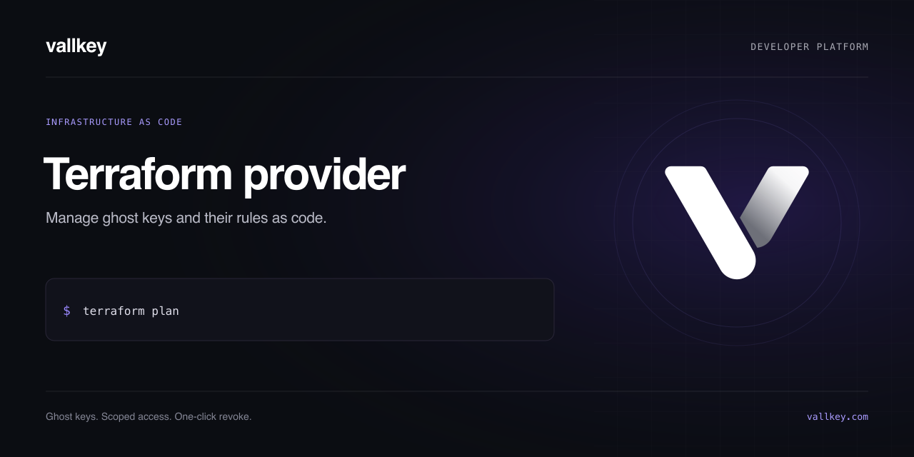

[](https://github.com/vallkeyhq/terraform-provider-vallkey/actions/workflows/checks.yml)
[](https://github.com/vallkeyhq/terraform-provider-vallkey/actions/workflows/secrets.yml)
[](LICENSE)

# Terraform provider for Vallkey

Manage Vallkey ghost keys and their rules as code, reviewed in pull requests like the rest of your infrastructure.

```hcl
terraform {
  required_providers {
    vallkey = { source = "vallkeyhq/vallkey" }
  }
}

provider "vallkey" {} # VALLKEY_TOKEN: an API token from Settings, API tokens

resource "vallkey_key" "chat" {
  service  = "openai"
  real_key = var.openai_key
  label    = "Chat backend"
  rules = jsonencode({
    allow         = [{ method = "POST", path = "/v1/chat/completions" }]
    ratePerMinute = 120
  })
}
```

**Publication status:** source preparation does not make this provider available in the public Terraform Registry. Until a signed release is registered, use a local build and `dev_overrides`.

See [examples/main.tf](examples/main.tf) for a custom API and more rules.

## Provider settings

| Setting | Environment variable | |
|---|---|---|
| `token` | `VALLKEY_TOKEN` | An API token. Required. |
| `api_url` | `VALLKEY_API_URL` | Defaults to `https://api.vallkey.com`. Accounts in the EU region use the address shown under Settings, API tokens. |

## `vallkey_key`

| Attribute | |
|---|---|
| `service` | The provider: `openai`, `anthropic`, `stripe`, `custom`, `aws`… Changing it makes a new key. |
| `real_key` | The real API key (sensitive). Changing it replaces the real key behind the same ghost key, after the account's safety delay. |
| `label`, `project`, `environment` | Name and grouping. `environment` is `production`, `staging` or `development`. |
| `rules` | The rules as JSON, written with `jsonencode`. Fields left out take the provider's defaults. Leave it out and Terraform does not manage the rules. |
| `custom` | For `service = "custom"`: `jsonencode({ origin, auth })`. Changing it makes a new key. |
| `aws` | For `service = "aws"`: `jsonencode({ endpoint, region, service })`. |
| `skip_check` | Create the key even if the provider refuses the real key in Vallkey's test request. |
| `ghost_key` | Read only, sensitive. The ghost key for your app, known only for keys Terraform created. |
| `effective_rules` | Read only. Every rule as Vallkey holds it, defaults included. |
| `rules_apply_at` | Read only. When looser rules waiting out the safety delay apply. |

**Safety rules still apply.** Stricter rules apply at once. Looser rules and a new real key wait out the account's safety delay, or a second admin's approval for production keys when the account asks for it. Terraform finishes and says when the change applies.

**Rules changed in the dashboard show up** as a difference on the next plan, so `terraform apply` puts back what the code says.

**Import** a key made in the dashboard with `terraform import vallkey_key.name <key id>`. Its real key is not compared: the `real_key` you configure is stored as it is, and only a later change replaces it. The ghost key of an imported key is not shown.

**State holds the real key.** Keep Terraform state in a backend that encrypts it, as with any secret.

## `vallkey_key` data source

Reads a key that already exists: `service`, `label`, `project`, `environment` and `rules`.

## Development

Use Go 1.26.10 or later so builds include the patched standard library.

```sh
go test ./...
go build -o terraform-provider-vallkey
```

To try a local build, point Terraform at it with a `dev_overrides` block for `vallkeyhq/vallkey` in `~/.terraformrc`.

## Releasing

The Terraform Registry reads providers from a public GitHub repository named `terraform-provider-vallkey`, with releases signed by a GPG key added to the registry.

1. Review and merge the release source in `github.com/vallkeyhq/terraform-provider-vallkey`.
2. Add the GPG public key in the registry (registry.terraform.io, Publish, Provider, signing keys).
3. Tag a version (`v0.1.0`) and run `goreleaser release --clean` with `GPG_FINGERPRINT` set.
4. Publish the repository in the registry once.

## Contributing and security

See [CONTRIBUTING.md](CONTRIBUTING.md), [SECURITY.md](SECURITY.md), and the [MIT license](LICENSE). Registry reference documentation lives under [docs](docs/index.md).

`api_url` must be an HTTPS origin without credentials, path, query or fragment. Loopback HTTP is allowed for local testing. Authenticated API calls do not follow redirects.
